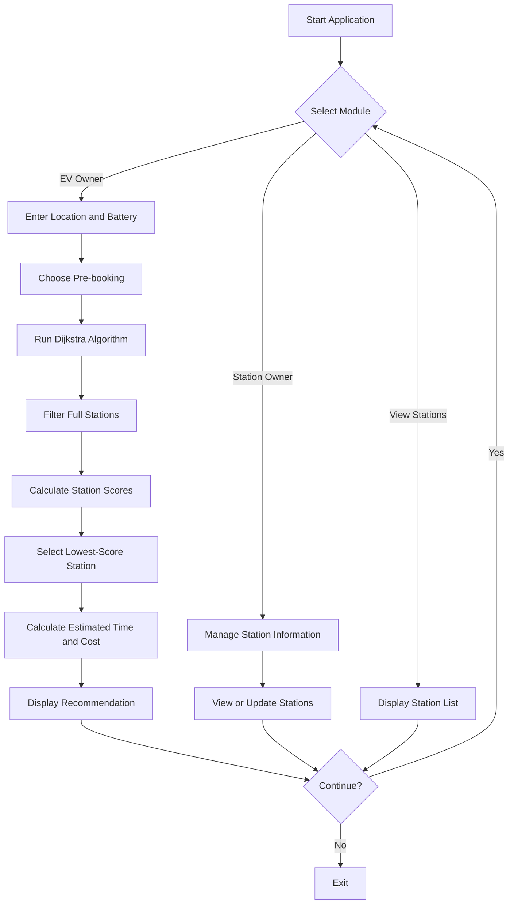

# EV Smart Station Optimizer

A C++ project that recommends suitable Electric Vehicle (EV) charging stations using graph algorithms and multi-factor cost optimization.

The system combines **Dijkstra's Shortest Path Algorithm**, graph data structures, and a greedy selection strategy to evaluate charging stations based on travel distance, battery level, station utilization, and charging price.

It includes separate menus for EV owners and charging station owners, along with an optional pre-booking feature.

> **Project scope:** This is an educational console-based simulation using a predefined road network and sample charging station data. It does not use live GPS, real-time charging station availability, live maps, or an external booking service.

---

## Table of Contents

- [Overview](#overview)
- [Features](#features)
- [How It Works](#how-it-works)
- [Recommendation Algorithm](#recommendation-algorithm)
- [Technology Stack](#technology-stack)
- [Screenshots](#screenshots)
- [Project Structure](#project-structure)
- [Getting Started](#getting-started)
- [Using the Application](#using-the-application)
- [Sample Network and Assumptions](#sample-network-and-assumptions)
- [Current Limitations](#current-limitations)
- [Future Improvements](#future-improvements)
- [Author](#author)
- [License](#license)

## Overview

Finding an EV charging station involves more than choosing the nearest location. A nearby station may be expensive or congested, while a slightly farther station may offer a better overall trade-off.

The EV Smart Station Optimizer models a network of connected locations and charging stations. It calculates shortest-path distances and evaluates available stations using a scoring function.

The application demonstrates how graph algorithms and basic optimization techniques can be applied to an EV charging scenario.

## Features

### EV Owner Module

- Enter the current location using a predefined location label (`A` to `F`).
- Enter the current battery percentage.
- Choose whether to pre-book a charging slot.
- Receive a recommended charging station.
- View station ID, charging price, graph distance, estimated travel time, estimated cost, and booking status.

### Charging Station Recommendation

- Represents the road network using a weighted, undirected graph.
- Uses Dijkstra's algorithm to calculate shortest-path distances.
- Excludes stations whose current load has reached or exceeded their capacity.
- Evaluates stations using distance, battery level, station utilization, and charging price.
- Selects the available station with the lowest calculated score.

### Station Owner Module

The station owner can:

- View configured charging stations.
- Update station load.
- Update station capacity.
- Add a new charging station.
- Update charging prices.

### Station List

Users can view station information, including:

- Station ID
- Location node
- Charging price
- Configured capacity
- Current load
- Calculated number of free slots

## How It Works

The application follows this general workflow:

1. The user selects the EV Owner option.
2. The user enters a starting location and battery percentage.
3. The user chooses whether to pre-book.
4. Dijkstra's algorithm calculates shortest-path distances from the selected location.
5. Stations with no remaining capacity are excluded.
6. The remaining stations are evaluated using a multi-factor cost score.
7. The station with the lowest score is selected.
8. The application calculates estimated travel time and charging cost.
9. The result and booking status are displayed.

The Station Owner module provides separate functionality for viewing and modifying station data.

### System Workflow



## Recommendation Algorithm

### 1. Graph Representation

The road network is represented as a weighted, undirected graph using an adjacency list.

- Vertices represent locations.
- Edges represent connections between locations.
- Edge weights represent distances between connected locations.

The graph is stored using a vector of adjacency lists in C++.

### 2. Dijkstra's Shortest Path Algorithm

Dijkstra's algorithm finds the shortest distance from the EV's starting location to each reachable location in the graph.

A min-priority queue is used to process the next location with the smallest known distance.

### 3. Multi-Factor Station Scoring

The current implementation evaluates candidate stations using the following factors:

- Shortest-path distance
- Battery urgency when battery level is below 20%
- Station utilization relative to capacity
- Charging price

The scoring logic can be summarized as:

```text
score = distance

if battery < 20:
    score += 2 * distance

score += integer_part((load / capacity) * 20)
score += 2 * charging_price
```

The station with the lowest score is selected among stations that have available capacity.

**Implementation note:** The pre-booking choice does not currently affect the station recommendation score. Booking adds a fixed fee to the estimated charging cost and increments the selected station's load. It is a simplified simulation, not a time-slot reservation system.

### 4. Estimated Travel Time

The current model estimates travel time using:

```text
estimated_time = distance * 2 minutes
```

This is a fixed demonstration assumption, not a calculation based on actual traffic or road speeds.

### 5. Estimated Charging Cost

The application estimates the battery level after travel using an assumed consumption of two battery percentage points per distance unit.

The remaining battery level is then used to estimate the charging requirement. The estimated cost is calculated using the configured station price, with an additional fixed booking fee of 50 when pre-booking is selected.

These values are illustrative outputs based on the program's assumptions, not live EV energy or billing estimates.

## Technology Stack

| Technology | Purpose |
|---|---|
| C++ | Core application |
| Object-Oriented Programming | Models EVs, charging stations, edges, and graphs |
| Graph Data Structure | Represents the road network |
| Dijkstra's Algorithm | Calculates shortest-path distances |
| Greedy Selection | Selects the station with the lowest calculated score |
| Standard Template Library (STL) | Uses vectors, pairs, and a priority queue |
| Min-Heap Priority Queue | Supports shortest-path computation |

## Screenshots

### Main Menu


### Charging Station Recommendation


### Station Owner Module


## Project Structure

```text
EV-Smart-Station-Optimizer/
├── main.cpp
├── README.md
├── LICENSE
├── .gitignore
└── screenshots/
    ├── Screenshot 2026-08-07 114419.png
    ├── Screenshot 2026-08-07 114435.png
    └── Screenshot 2026-08-07 114451.png
```

## Getting Started

### Prerequisites

Install a C++ compiler that supports C++11 or later.

Examples include:

- GCC / G++
- MinGW-w64 on Windows
- A compatible C++ development environment

No external libraries are required by the current implementation.

### 1. Clone the Repository

```bash
git clone https://github.com/siddhi-0811/EV-Smart-Station-Optimizer.git
cd EV-Smart-Station-Optimizer
```

### 2. Compile the Program

Using GCC or MinGW:

```bash
g++ -std=c++11 -Wall -Wextra main.cpp -o ev
```

On Windows, you can also compile to an executable named `ev.exe`:

```powershell
g++ -std=c++11 -Wall -Wextra main.cpp -o ev.exe
```

### 3. Run the Application

On Linux or macOS:

```bash
./ev
```

On Windows PowerShell:

```powershell
.\ev.exe
```

The main menu will appear in the terminal.

## Using the Application

### EV Owner

1. Select option `1` from the main menu.
2. Enter a valid starting location from `A` to `F`.
3. Enter the battery percentage.
4. Select whether to pre-book.
5. Review the recommended station and estimated costs.

### Station Owner

1. Select option `2`.
2. Choose an operation from the Station Owner menu.
3. View or update station load, capacity, price, or add a station.

### View Station List

Select option `3` to display the configured stations and their calculated free slots.

### Exit

Select option `4` to terminate the application.

**Input note:** Use the expected numeric options and valid location labels. The current code has limited input validation, so invalid values may produce unreliable results.

## Sample Network and Assumptions

The application uses a predefined graph with 15 location nodes and five initial charging stations.

The initial stations are configured with different locations, capacities, loads, and prices to demonstrate how distance, availability, and pricing can influence the recommendation.

The simulation assumes:

- Distances are abstract graph weights rather than real geographic measurements.
- Station load and capacity are entered or updated within the application.
- Estimated travel time uses a fixed time-per-distance value.
- Battery consumption is represented by a simplified formula.
- Charging prices use sample values.
- Booking is represented by a load increment and fixed fee.

The outputs should be interpreted as educational examples rather than real-world charging recommendations.

## Current Limitations

- The graph is predefined and does not use GPS coordinates or actual roads.
- Station availability and prices are not retrieved from live services.
- The recommendation score uses a simplified heuristic rather than a calibrated optimization model.
- Booking does not reserve a real charging time slot.
- Travel time and charging cost are based on assumptions.
- Input validation and bounds checking can be improved.
- Updates to station data are held in memory while the program is running and are not persisted to a database or file.
- The application is a command-line simulation and has no graphical user interface.

## Future Improvements

Potential improvements include:

- Integrating live location and map data.
- Adding real-time station availability and pricing.
- Implementing proper charging-slot reservations.
- Validating battery percentages, station IDs, loads, and capacities.
- Improving the recommendation score with normalized weights and configurable user preferences.
- Estimating energy consumption and charging duration using EV-specific parameters.
- Adding persistent storage for station information.
- Developing a graphical or mobile user interface.
- Adding unit tests for shortest-path calculations, station filtering, and scoring logic.

## Author

**Siddhi Singh**

B.Tech Computer Science and Engineering  
Artificial Intelligence and Data Science  
MIT World Peace University, Pune

## License

This project is distributed under the MIT License. See the [LICENSE](LICENSE) file for details.
