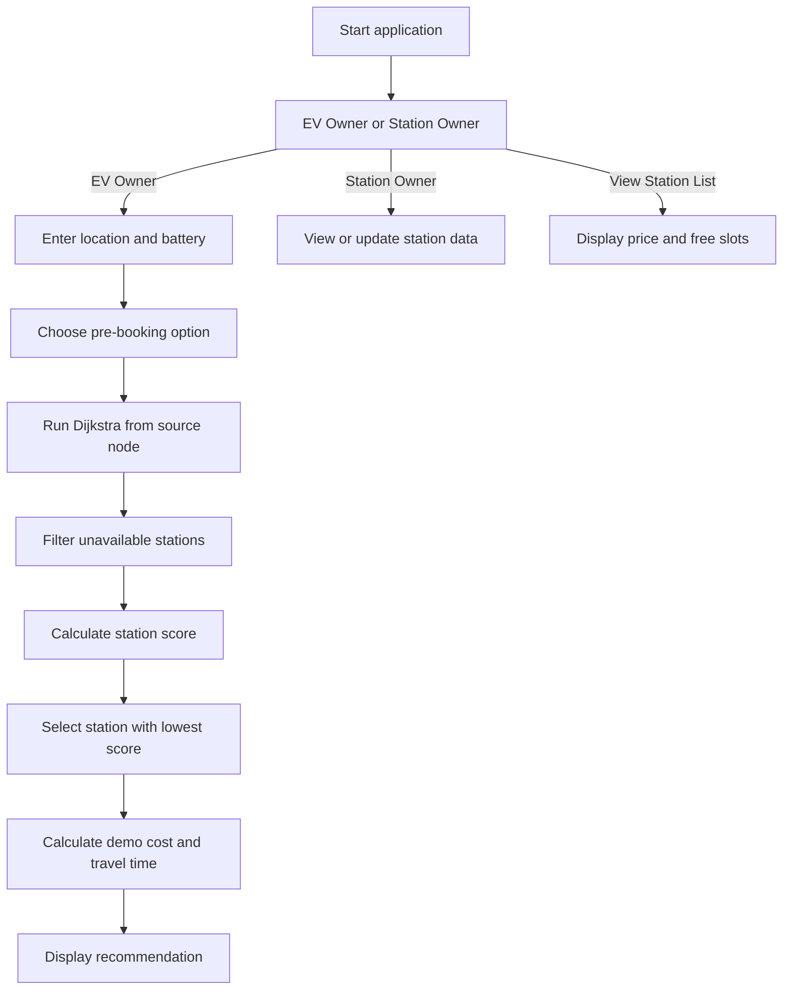

EV Smart Station Optimizer
A menu-driven C++ project that recommends an electric vehicle (EV) charging station using graph-based shortest paths and a multi-factor scoring heuristic.

The project models a small road network, calculates distances from an EV's current node using Dijkstra's shortest-path algorithm, and ranks available charging stations using distance, battery level, station utilization, and charging price. It also includes simple EV-owner and station-owner menus, plus an optional pre-booking choice.
Project scope: This is an educational console-based simulation with a predefined graph and sample station data. It does not use live maps, GPS, real charging-network data, or an actual reservation service.

Table of Contents
- Features
- How It Works
- Recommendation Logic
- Screenshots
- Technology Stack
- Repository Structure
- Getting Started
- Using the Application
- Sample Network and Assumptions
- Current Limitations
- Potential Improvements
- Author
- License
Features
EV Owner Module
- Enter a starting location (A through F) and battery percentage.
- Choose whether to pre-book during the recommendation flow.
- Receive a recommended station based on the current graph and station state.
- View the assigned station ID, price per unit, graph distance, estimated time, estimated total cost, and booking status.
Charging Station Recommendation
- Represents locations and routes as a weighted, undirected graph.
- Uses Dijkstra's algorithm to find shortest-path distances from the EV's starting node.
- Skips stations whose configured load is at or above their capacity.
- Scores the remaining stations using distance, low-battery urgency, utilization, and price.
Station Owner Module
- View configured stations.
- Update a station's current load.
- Update station capacity.
- Add a station to the list.
- Update charging price.
Station List
View station IDs, graph-node locations, prices, and free slots calculated as capacity - load.
How It Works

Algorithm Overview
1. Graph construction: The program loads a predefined weighted road network into an adjacency list.
2. Shortest paths: Dijkstra's algorithm calculates the minimum graph distance from the EV's starting node to each reachable node.
3. Availability filtering: A station is skipped when load >= capacity.
4. Station scoring: Each remaining station is given a score. The station with the lowest score is selected.
5. Result calculation: The application calculates a simplified estimated total cost and estimated time, then displays the station and booking status.
Recommendation Logic
The current source code uses this station score:
- Start with the shortest-path distance.
- If battery is below 20%, add an extra 2 × distance penalty to prioritize nearer stations.
- Add a utilization penalty: (load / capacity) × 20.
- Add a price penalty: 2 × price.
The station with the smallest score is selected from the stations that have remaining capacity. This is a hand-designed scoring heuristic, not a learned AI model or a mathematically calibrated real-world cost function.
Booking behavior in the current implementation
Pre-booking currently affects the estimated total cost by adding a fixed fee of 50 and increments the selected station's load after selection. The booking choice is not currently included in the station-ranking score itself, and the application does not create or persist a real reservation record. This distinction is documented so the README accurately reflects the code.
Simplified cost and time estimates
The current code uses illustrative assumptions:
- Travel consumes 2 battery-percentage points per graph-distance unit.
- Estimated time is 2 minutes per graph-distance unit.
- Estimated charging cost is based on the calculated energy amount multiplied by the station's price, plus the fixed booking fee when booking is selected.
These values are hard-coded demonstration assumptions, not predictions based on a vehicle model, battery capacity in kWh, charger power, actual speed, or real-world currency/energy units.
Screenshots
Main Menu

Charging Station Recommendation

Station Owner Module

Technology Stack
Technology / Concept	Use
C++	Application logic and console interface
Object-oriented programming	Graph, Edge, EV, and Station classes
Graphs and adjacency lists	Modeling locations and weighted routes
Dijkstra's algorithm	Shortest-path distance calculation
Greedy selection	Selects the available station with the lowest score
STL vector	Stores graph edges, distances, and stations
STL priority_queue	Min-heap used by Dijkstra's algorithm

Repository Structure
EV-Smart-Station-Optimizer/
├── main.cpp
├── README.md
├── LICENSE
├── .gitignore
└── screenshots/
    ├── Screenshot 2026-08-07 114419.png
    ├── Screenshot 2026-08-07 114435.png
    └── Screenshot 2026-08-07 114451.png
Getting Started
Prerequisites
Install a C++ compiler that supports C++11 or later. Examples include:
- Windows: MinGW-w64 / GCC or a compatible C++ compiler.
- Linux: GCC or Clang.
- macOS: Apple Clang or GCC.
1. Clone the repository
git clone https://github.com/siddhi-0811/EV-Smart-Station-Optimizer.git
cd EV-Smart-Station-Optimizer
If you already cloned the project into a differently named local folder, you can keep using that folder; the local folder name does not have to match the GitHub repository name.
2. Compile
Windows (MinGW-w64):
g++ -std=c++11 -Wall -Wextra main.cpp -o ev.exe
Linux / macOS:
g++ -std=c++11 -Wall -Wextra main.cpp -o ev
Compiler warnings may identify opportunities for additional cleanup; the program does not need any third-party libraries.
3. Run
Windows PowerShell:
.\ev.exe
Linux / macOS:
./ev
Using the Application
When the program starts, it displays a menu similar to:
====== EV SYSTEM ======
1. EV Owner
2. Station Owner
3. View Station List
4. Exit
- Select 1 to enter a location (A–F), battery percentage, and booking choice, then view the recommended station.
- Select 2 to open the station-owner menu for viewing or updating station information.
- Select 3 to view stations, their graph locations, prices, and free-slot counts.
- Select 4 to exit.
The initial graph and stations are hard-coded in main.cpp. Changes made through the station-owner menu affect the current running session; the program does not save them to a database or file.
Sample Network and Assumptions
The source code creates a graph with 15 nodes and predefined weighted edges. The user-facing EV location input maps A–F to node indices 0–5. The initial station definitions use node indices 3, 6, 9, 11, and 14.

The edge weights are demonstration distance units. The sample network is not geospatially calibrated, and the station recommendations should be interpreted as results for this simulated graph rather than real charging-station directions.
Current Limitations
- Hard-coded topology: Locations, routes, station definitions, and weights are configured in the source code rather than loaded from a map or data file.
- Input validation: Invalid location strings currently fall back to node A; battery percentage and station-management inputs do not receive comprehensive validation.
- Booking is simulated: A selected booking adds a fixed fee and increments station load, but there is no booking ID, time slot, cancellation, or persistent reservation store.
- Scoring is heuristic: The relative weights are fixed constants and are not calibrated against real-world EV usage.
- Simplified cost/time: The calculations do not model actual battery capacity, charger power, energy tariffs, route traffic, or vehicle-specific consumption.
- Session-only updates: Station changes are lost when the program exits.
- Capacity/load consistency: Station-owner updates should validate that capacity is positive and load remains within valid bounds.
- Connectivity: The program does not use live location, maps, network APIs, or a database.
Potential Improvements
1. Validate all console input, including location, battery percentage, station IDs, capacity, load, and price.
2. Make pre-booking meaningfully influence selection and introduce explicit slot availability and reservation state.
3. Separate graph algorithms, station scoring, input/output, and station management into modules or classes with clearer responsibilities.
4. Replace the hard-coded demo map with a configurable graph file or real road-network integration.
5. Use realistic EV parameters such as battery capacity (kWh), vehicle efficiency, charging power, energy tariffs, and estimated arrival time.
6. Persist station data between runs using a file or database.
7. Add automated tests for Dijkstra, unreachable nodes, full stations, invalid input, scoring, and cost calculations.
8. Add a GUI or web interface once the core logic is tested.
Author
Siddhi Singh
B.Tech, Computer Science & Engineering (AI & Data Science)
MIT World Peace University
License
This project is distributed under the MIT License.
